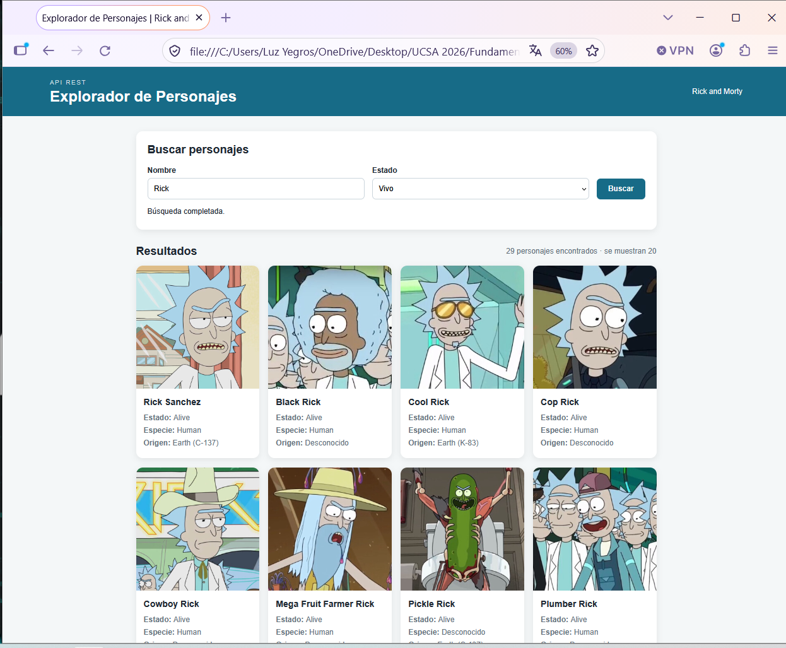

# Explorador de Personajes de Rick and Morty

Aplicación web desarrollada para explorar personajes de la serie Rick and Morty mediante el consumo de una API REST. Permite realizar búsquedas por nombre y filtrar personajes según su estado, mostrando los resultados de forma dinámica.

**Autora:** Angela Luz Yegros · Fundamentos de Desarrollo Web · UCSA  
**Variante del TP:** A · Personajes

## Sitios publicados

- GitHub Pages: https://luzyegros.github.io/tp-yegros-angela-luz/
- Vercel: pendiente de despliegue

## Captura



## Funcionalidades

- Buscar personajes por nombre.
- Filtrar personajes por estado: vivo, muerto o desconocido.
- Consumir datos de la API REST de Rick and Morty mediante Fetch API.
- Mostrar los resultados dinámicamente en tarjetas.
- Mostrar imagen, nombre, estado, especie y lugar de origen de cada personaje.
- Informar al usuario cuando no se encuentran personajes con los filtros seleccionados.
- Manejar errores durante la consulta a la API.
- Guardar la última búsqueda mediante localStorage.
- Restaurar automáticamente la última búsqueda almacenada.

## Tecnologías

- HTML5
- CSS3
- CSS Grid
- Flexbox
- JavaScript ES6+
- Fetch API
- async/await
- localStorage
- API de Rick and Morty

## Estructura del proyecto

```text
tp-yegros-angela-luz/
├── index.html
├── README.md
├── .gitignore
├── css/
│   └── estilos.css
├── js/
│   └── app.js
└── img/
    └── captura.png